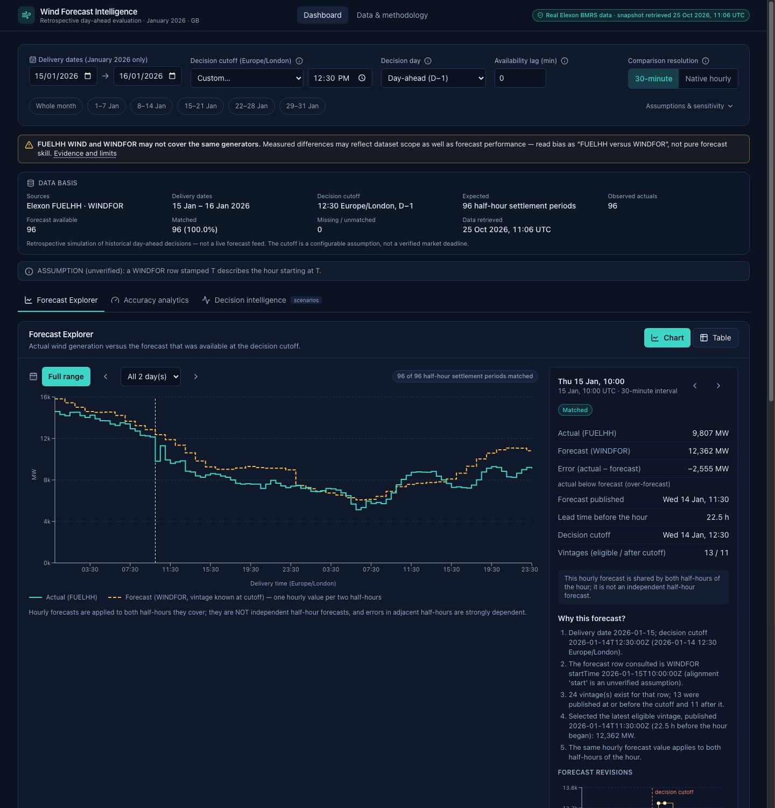
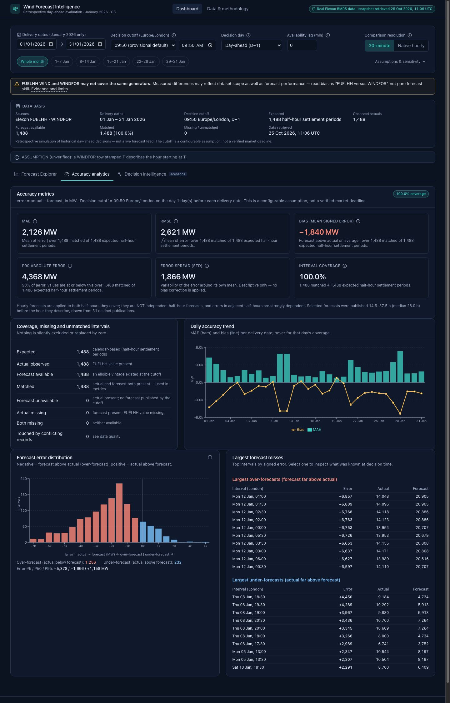
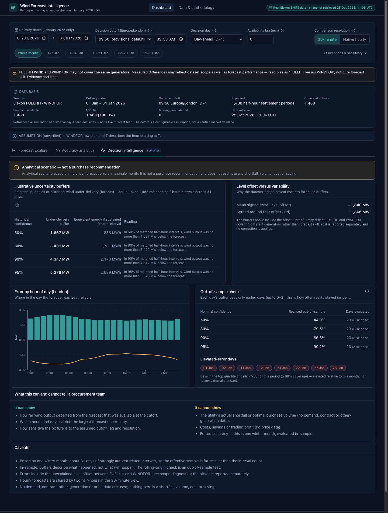
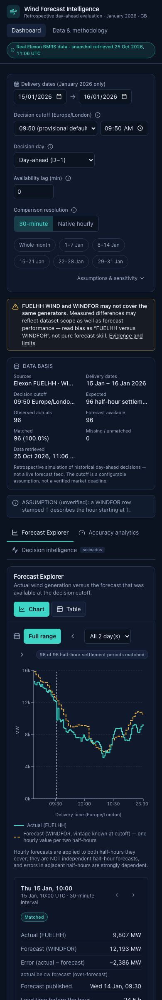

# UK Wind Forecast Intelligence Platform

A retrospective evaluation tool for **day-ahead wind generation forecasts in Great Britain, January 2026 deliveries**, built on Elexon BMRS data (**FUELHH** actuals, **WINDFOR** forecasts).

It answers three questions a procurement team would ask:

1. *What wind forecast could we actually have seen when the day-ahead decision had to be made?*
2. *How accurate was it, quantitatively?*
3. *How much uncertainty does that leave, and where is the data missing or ambiguous?*

> **It is a retrospective simulation of historical decision-making — not a live forecast feed, and not purchase advice.** It has no demand, contract, other-generation or price data, so it never claims a shortfall, an optimal volume, a cost, a saving or a profit.

| | |
|---|---|
| **Live deployment** | _Not deployed yet — awaiting the owner's approval._ (URL will be added here.) |
| **Stack** | React 19 + TypeScript · Python 3.12 + FastAPI · pandas/NumPy · Docker/Compose |
| **Tests** | 263 backend (pytest) · 48 frontend (Vitest + Testing Library) |



_Screenshots show real Elexon data from the committed snapshot (taken before the final wording changes; the attribution footer now flags its wording as unverified). A "SYNTHETIC DEVELOPMENT FIXTURE" badge replaces the green "Real Elexon BMRS data" badge whenever synthetic data is in use._

<details><summary>More screenshots</summary>




</details>

---

## 1. What the correctness depends on

For each delivery interval the app reproduces what was knowable at the **decision cutoff**, not what is knowable today.

1. Cutoff instant = a clock time (default **09:50 Europe/London**) on the day *before* delivery (`days_before`, default 1), minus an optional *availability lag* (default 0).
2. Eligible forecasts: WINDFOR rows targeting that interval with `publishTime` **at or before** the cutoff and **before** the hour they describe. Later revisions are excluded even if they are better.
3. Select the **latest** eligible vintage. If none exists the interval is **unavailable** — never zero.
4. Match to the actual by **delivery interval**, never by publication time.
5. Duplicate records that disagree are **removed, counted, listed and flagged** — never silently resolved.

The cutoff presets (09:50, 09:20, 15:30) are **configurable assumptions, not verified market deadlines** (see §8).

### Metrics (`error = actual − forecast`, MW)

| Metric | Definition |
|---|---|
| Signed error | `e = actual − forecast`. Positive: actual exceeded forecast. Negative: forecast was too high (over-forecast). |
| MAE | `mean(|e|)` |
| RMSE | `√ mean(e²)` |
| Bias | `mean(e)` |
| P90 absolute error | 90th percentile of `|e|`, linear interpolation |
| Error spread | `std(e)`; identity `RMSE² = bias² + spread²` (separates a level offset from variability) |
| Coverage | `matched ÷ expected`, where *expected* comes from the **calendar** (48 half-hours per normal day; 46/50 on clock-change days), not from the data |

Metrics use matched intervals only. Nothing is imputed, interpolated or zero-filled, and every figure is displayed with its `matched of expected` denominator. Full specification: [`docs/planning/05-analytics-methodology.md`](docs/planning/05-analytics-methodology.md).

---

## 2. Findings from the data research (read before interpreting results)

All verified against live API responses; reproducible with the scripts in [`docs/planning/research/`](docs/planning/research).

- **WINDFOR is hourly; FUELHH is half-hourly.** The app offers a 30-minute view (each hourly forecast shared by two half-hours) *and* a native hourly view. The two half-hours are not independent forecasts.
- **WINDFOR keeps every revision** with its original `publishTime` (312 vintages × 73 hourly rows for the study window), so a true point-in-time reconstruction is possible. It cannot be filtered by delivery time, only by publish time.
- **Hour alignment is unverified.** No official source states whether a row stamped `T` describes the hour starting or ending at `T`. The default (`start`) is an explicit, labelled assumption chosen from the field name and Elexon's settlement-period labelling — **not** from error statistics. The alternative is available as a sensitivity switch.
- **A large systematic bias exists (forecast ≈ 1.8 GW above FUELHH WIND), and it is largely a dataset-scope effect, not demonstrated forecast skill.** FUELHH WIND is below another BMRS wind-outturn series (B1630) in 99.9 % of half-hours, by ≈ 2.2 GW on average, in every month from October 2025 to January 2026; against that series the same forecast has a January bias of **+0.4 GW** (MAE 1,338 MW vs 2,126 MW against FUELHH). Not a unit error, not a cutoff/vintage artefact, not a duplicate/alignment artefact (all checked). **What exactly each dataset covers is not established.** The UI says so on every view; no bias correction is applied. Details: [`docs/planning/04-data-research-notes.md`](docs/planning/04-data-research-notes.md) §9–10.
- **Real-data quirks are handled, not hidden:** on 2026-01-15 the 11:30Z forecast is absent, an off-schedule 12:25Z one exists, and four FUELHH periods were published late. The Data & methodology page lists such anomalies, derived from the data itself (the nominal publication schedule is never assumed).

---

## 3. Architecture

```
 Elexon Insights API ──► ingestion CLI ──► snapshot (data/snapshots, SHA-256 manifest) ──► repository ──► pure analytics core ──► FastAPI /api/v1 ──► React SPA
 FUELHH, WINDFOR        retry/back-off      verbatim rows + provenance (offline, pinned)    normalise     calendar · selection ·      thin routes,      charts, tables,
                        atomic write                                                        + conflicts   matching · metrics ·        typed schemas     methodology
                                                                                                         scenarios
```

- **Pure core** (`backend/app/domain`): no I/O or framework imports; fully unit-tested without the network.
- **Snapshot by default**: the app runs from a committed, hash-verified copy of real January 2026 data, so it is deterministic and independent of Elexon's availability. Live ingestion is an explicit CLI command; the app never silently falls back to other data.
- **Single deployable**: the production image serves the API and the built React app from one origin.
- **URL is the state**: date range, cutoff, lag, resolution, assumptions and selected interval live in the query string, so any view is shareable.

### Repository structure

```
.
├── README.md  LICENSE  NOTICE  .env.example  .gitignore  .dockerignore
├── Dockerfile  docker-compose.yml        # local/self-hosted container
├── vercel.json  requirements.txt  api/    # Vercel deployment (static UI + FastAPI function)
├── data/snapshots/              # pinned REAL Elexon snapshot + manifest.json + README (provenance, licence note)
├── backend/
│   ├── pyproject.toml  uv.lock
│   ├── app/
│   │   ├── main.py  config.py  logging.py  cli.py
│   │   ├── api/routes.py        # thin HTTP layer
│   │   ├── schemas/models.py    # request/response contract (Pydantic v2)
│   │   ├── services/            # AnalysisService (+ memoisation), static content
│   │   ├── domain/              # calendar · normalise · selection · analysis · metrics · scenarios
│   │   ├── ingestion/           # Elexon client · snapshot writer/reader · synthetic data
│   │   └── repository/          # snapshot / live / synthetic data sources
│   └── tests/                   # unit · integration · api · regression (real snapshot)
├── frontend/
│   └── src/
│       ├── api/                 # types, client, TanStack Query hooks
│       ├── lib/                 # params (URL state), formatting
│       ├── components/          # states, banners, UI primitives
│       ├── features/            # controls · explorer · accuracy · decision · methodology
│       └── test/                # harness, typed SYNTHETIC fixtures, tests
└── docs/
    ├── planning/                # requirements, design, methodology, research notes, risks, time log
    ├── demo/                    # customer pitch + technical walkthrough scripts
    └── images/
```

### Technology choices

| Choice | Why |
|---|---|
| FastAPI + Pydantic v2 | typed contract, automatic OpenAPI (`/docs`), validation with a consistent error envelope |
| pandas/NumPy | NumPy for pinned percentile/aggregation semantics; the dataset (~24 k rows) needs no database |
| uv + lockfiles | reproducible installs |
| React + TypeScript (strict) | domain types mirror the API; compile-time safety |
| Tailwind CSS 4, Radix primitives, Recharts | accessible primitives, custom dark design system, charts with real gaps |
| TanStack Query | cache/retry/loading/error state per panel |
| Vitest + Testing Library | component and integration tests against a mocked API |

---

## 4. Quick start

Prerequisites: Python 3.12, [uv](https://docs.astral.sh/uv/), Node 22 (Node ≥ 20.19 works), npm.

```bash
# Backend (http://localhost:8000, interactive docs at /docs)
cd backend
uv sync
uv run uvicorn app.main:app --reload

# Frontend (http://localhost:5173, proxies /api to :8000)
cd frontend
npm ci
npm run dev
```

No API key or account is needed. Copy `.env.example` to `.env` only if you want to change defaults.

### Docker

```bash
docker compose up --build                       # production-like: API + UI on http://localhost:8000
docker compose --profile dev up --build backend-dev frontend-dev    # hot reload: UI :5173, API :8000
docker compose --profile test run --rm test-backend
docker compose --profile test run --rm test-frontend
```

> **Verification status (Docker Desktop 27.4, macOS):** `docker compose up --build` **was run successfully** on the development machine: the production image built, the container ran as a non-root user with a read-only filesystem and reported *healthy*, and the UI and API were served from the same origin (`localhost:8000`) with the bundled snapshot (1,488 of 1,488 intervals matched; MAE 2,126 MW, RMSE 2,621 MW, bias −1,840 MW; CSP and security headers present). A fresh-profile headless-browser session loaded the dashboard, selected an interval, changed the cutoff 09:50 → 09:20 (MAE 2,126 → 2,145 MW) and opened the methodology page with no console errors. **Not verified:** the `dev` and `test` compose profiles (a second image build failed with an I/O error when the host disk filled up; the same suites were run natively instead), and a repeat build after that incident.

### Tests and quality gates

```bash
cd backend  && uv run pytest --cov=app && uv run ruff check . && uv run mypy app
cd frontend && npx tsc --noEmit && npm run lint && npm test && npm run build
```

### Refreshing the data snapshot (optional)

```bash
cd backend
uv run python -m app.cli verify-snapshot     # integrity check
uv run python -m app.cli ingest              # re-fetch from Elexon; atomic, leaves the old snapshot intact on failure
```

---

## 5. Configuration

All values have safe defaults; see [`.env.example`](.env.example).

| Variable | Default | Meaning |
|---|---|---|
| `DATA_SOURCE_MODE` | `snapshot` | `snapshot` (pinned real data) · `live` (fetch at startup) · `synthetic` (labelled dev data) |
| `DATA_SNAPSHOT_DIR` | `./data/snapshots` | snapshot location |
| `DECISION_CUTOFF_TIME` | `09:50` | default cutoff clock time (Europe/London) |
| `DECISION_DAYS_BEFORE_DELIVERY` | `1` | decision day = delivery date − N |
| `FORECAST_AVAILABILITY_LAG_MINUTES` | `0` | delay between `publishTime` and usability |
| `HOUR_ALIGNMENT` | `start` | **unverified assumption** (`start` / `end`) |
| `DUPLICATE_CONFLICT_POLICY` | `exclude` | `exclude` (fall back, flag) · `strict` (interval unavailable) |
| `ANALYSIS_START_DATE` / `END_DATE` | 2026-01-01 / 2026-01-31 | permitted delivery window |
| `FRONTEND_DIST_DIR` | _unset_ | when set, the API also serves the built SPA (set in the Docker image) |
| `CORS_ALLOW_ORIGINS` | _empty_ | dev only |
| `VITE_API_BASE_URL` | _empty_ | frontend → API base URL (empty = same origin) |

---

## 6. API

Base path `/api/v1`. All analytic endpoints accept the same optional query parameters: `delivery_start`, `delivery_end` (inside 2026-01-01…31, else `422 OUT_OF_RANGE`), `cutoff_time` (`HH:MM`), `cutoff_timezone`, `days_before` (0–3), `availability_lag_minutes` (0–720), `resolution` (`half_hour`|`hourly`), `hour_alignment` (`start`|`end`), `conflict_policy`, `top_k`, `histogram_bin_mw`. Unknown parameters are rejected.

| Endpoint | Purpose |
|---|---|
| `GET /health` | liveness; `degraded` if the dataset failed to load (other endpoints then return `503 DATA_UNAVAILABLE`) |
| `GET /meta` | permitted window, defaults, cutoff presets (flagged as assumptions), datasets, provenance, attribution, scope diagnostic |
| `GET /analysis/summary` | counts (expected/observed/matched/missing), metrics, daily metrics, error distribution, largest misses, elevated days, warnings |
| `GET /analysis/intervals` | every interval with actual, selected forecast, error, status, publish time, lead time, vintage counts (`null`, never 0, when missing) |
| `GET /intervals/{start_utc}/revisions` | all vintages for one interval (eligible / selected / after cutoff / back-cast), error-if-used, and a plain-language explanation |
| `GET /uncertainty/scenarios` | illustrative buffers, bands, breakdowns, out-of-sample check — always with the scenario disclaimer |
| `GET /data-quality` | normalisation counters, conflicts, observed anomalies, assumptions, limitations, provenance |

Every analytic payload (`summary`, `intervals`, `revisions`, `scenarios`) carries a `scope_notice` field repeating the FUELHH/WINDFOR scope caveat; `/meta` carries the full diagnostic and the (unverified) attribution status.

Errors use one envelope: `{"error": {"code": "VALIDATION_ERROR|OUT_OF_RANGE|NOT_FOUND|DATA_UNAVAILABLE|INTERNAL", "message": "...", "details": [...]}}`. Interactive documentation is served at `/docs`.

---

## 7. Product tour

- **Forecast Explorer** — actual vs the forecast known at the cutoff; click or arrow-key through intervals; the inspector shows publication time, lead time, signed error, *why this vintage was selected*, and a revision timeline with the cutoff marked. Unavailable forecasts and missing actuals are hatched gaps with their own legend entries, never zeros. A table view mirrors the chart.
- **Accuracy analytics** — MAE, RMSE, bias, P90, spread and coverage with definitions in tooltips; daily trend; error distribution; largest over-/under-forecasts; exact missing/unmatched accounting.
- **Decision intelligence (scenarios)** — empirical under-delivery buffers at 50/80/90/95 %, level offset vs variability, error by hour of day, elevated-error days, and an **out-of-sample** check (each day's buffer uses only days ≤ D−2). Prominently labelled *illustrative — not a purchase or trading recommendation*.
- **Data & methodology** — sources with links, selection rule, formulas, scope evidence, assumptions, limitations, live data-quality for the current selection.

---

## 8. Assumptions, limitations and known data-quality issues

- **Cutoff is an assumption.** 09:50 is taken from a Nord Pool support page (modified 2022) for the N2EX day-ahead auction; 09:20 and 15:30 come from EPEX SPOT sources that could not be opened (HTTP 403) and are unverified. Whether these were the relevant venues in January 2026 is not confirmed. Results are sensitive to the choice (exploratory MAE 1,941–2,145 MW across cutoffs).
- **`publishTime` ≠ guaranteed availability.** Use the availability-lag control to test sensitivity.
- **Dataset-scope mismatch** between FUELHH WIND and WINDFOR (§2). Treat bias as "FUELHH versus WINDFOR".
- **Hour alignment unverified**; hourly forecast shared by two half-hours; adjacent half-hour errors are dependent, so the effective sample is smaller than the interval count.
- **One winter month.** No seasonal generalisation; tail statistics (P90/P95) are imprecise; scenario buffers are in-sample and descriptive.
- **Actuals are as served today**; later corrections (if any) are not observable. The WINDFOR publication times in UTC differ between winter and summer and from Elexon's documented list — the app only uses observed `publishTime` values.
- **Not established:** the BMRS licence text could not be retrieved (Elexon's site blocks automated access). The attribution wording comes from a third-party catalogue and is displayed as unverified (§10).
- **Docker:** production compose service verified; dev/test profiles not (see §4). **Deployment** is documented in §9.

---

## 9. Deployment

The deployment target is **Vercel** (one project, FastAPI preset): the build installs the pinned Python dependencies from [`requirements.txt`](requirements.txt), builds the React app in the project build command, and bundles the UI, the API code and the pinned January 2026 snapshot into one Python Function ([`api/index.py`](api/index.py)) that serves both the UI and `/api/*`. Configuration: [`vercel.json`](vercel.json). The deployed app needs no database and makes no calls to Elexon at runtime. Vercel's documentation (checked 2026-10-25/26) lists a 500 MB uncompressed bundle limit (this bundle is ≈ 114 MB) and a read-only filesystem (the app writes nothing).

**To deploy** (needs the owner's Vercel account): import the GitHub repository (framework preset *FastAPI*/*Other*, root directory = repository root) or run `npx vercel --prod` after `vercel login`. **Do not set a custom Install Command** — it replaces the Python dependency installation (this caused the first deployment to fail; see [`docs/planning/07-deployment-plan.md`](docs/planning/07-deployment-plan.md) §8).

**Verification status:** see the deployment section of the final report; a production URL is recorded here only after it has been verified.

---

## 10. Data source, licence and attribution

### The real-data snapshot (`data/snapshots/`)

| | |
|---|---|
| Nature | **Real** Elexon data, verbatim API rows. Never synthetic (`is_synthetic: false` in the manifest). Synthetic fixtures exist only in tests and an explicit dev mode, and are always labelled *SYNTHETIC DEVELOPMENT FIXTURE* in the UI. |
| Retrieved (UTC) | 2026-10-25T11:06:27Z |
| Delivery period | settlement dates 2026-01-01 to 2026-01-31 |
| WINDFOR publish window | 2025-12-27T00:00:00Z to 2026-02-04T00:00:00Z (every revision in the window, original `publishTime` kept) |
| Rows | FUELHH `WIND`: 1,488 · WINDFOR: 22,776 (312 vintages × 73 hourly rows) |
| Size | 124 KB (gzip CSV) |
| Integrity | SHA-256 per file and combined (`a4e5f8b3846eda77…`), verified on every load; the app refuses to start on a mismatch |
| How it was made | `python -m app.cli ingest` (two streaming requests; URLs and row counts are recorded in `manifest.json`) |
| Limitations | See §2 and §8: dataset-scope mismatch, unverified hour alignment, hourly vs half-hourly, one winter month, corrections not observable |

- Data: Elexon **BMRS Insights Solution API** — [FUELHH](https://bmrs.elexon.co.uk/api-documentation/endpoint/datasets/FUELHH/stream), [WINDFOR](https://bmrs.elexon.co.uk/api-documentation/endpoint/datasets/WINDFOR/stream). Provenance, retrieval time, period covered and limitations: [`data/snapshots/README.md`](data/snapshots/README.md) and `manifest.json`.
- **Attribution — unverified.** Elexon's developer portal says material may be reused for industry participation or non-commercial purposes *provided the source is acknowledged and the attribution in the BMRS Data Licence Terms is followed*. Those licence terms could not be retrieved (the Elexon site returns HTTP 403 to automated access). The wording this project displays — _"Contains BMRS data © Elexon Limited copyright and database right"_ — is reported by a third-party API catalogue (apis.io), **not** taken from an official Elexon page. It is shown in the UI together with a statement that it is unverified. **Before relying on this repository publicly, the owner should read the current BMRS Data Licence Terms and correct the wording if needed.**
- **Licences are separate.** Original project code is MIT ([`LICENSE`](LICENSE)). The MIT licence applies to the code only; it does not license, and must not be read as relicensing, any Elexon data. The committed snapshot (`data/snapshots/`) and all values derived from it remain subject to Elexon's terms ([`NOTICE`](NOTICE)).

---

## 11. AI-usage disclosure

This project was built with substantial AI assistance. It does not claim that every line was written by a person, nor that every line was written by an AI, and per-line authorship was not tracked.

- **Kiro** (an AI coding agent, run from the command line) drafted most of the repository content in sessions directed by the owner: the planning documents, the research probes, the backend and frontend code, the automated tests, the Docker and Vercel configuration, the screenshots and this README.
- **ChatGPT** was also used by the owner as an AI-assisted development tool. What it was used for is not recorded in this repository, so no specific file or task is attributed to it here.
- **Human role:** the owner set the requirements and made the product and analytical decisions (for example the default cutoff, how hourly forecasts are handled, how conflicting duplicates are treated, including a real data snapshot, the licence and the hosting target), and approved the plan and the implementation report at defined checkpoints. No claim is made of line-by-line human review.
- **How claims were checked rather than assumed:** data findings come from re-runnable scripts that call the public Elexon API ([`docs/planning/research/`](docs/planning/research)); the production analytics are tested against hand-computed examples, a brute-force oracle and an independent recomputation from the raw snapshot; items that could not be verified (Docker build, official licence wording, market deadlines, hour alignment) are listed in §8 as unverified instead of being asserted.

---

## 12. Planning and process documents

[`docs/planning/`](docs/planning/README.md): requirements, architecture, task plan, data research (verified facts vs assumptions vs unresolved), methodology, testing strategy, deployment plan, risk register, and the time log. Demo scripts: [`docs/demo/`](docs/demo).
